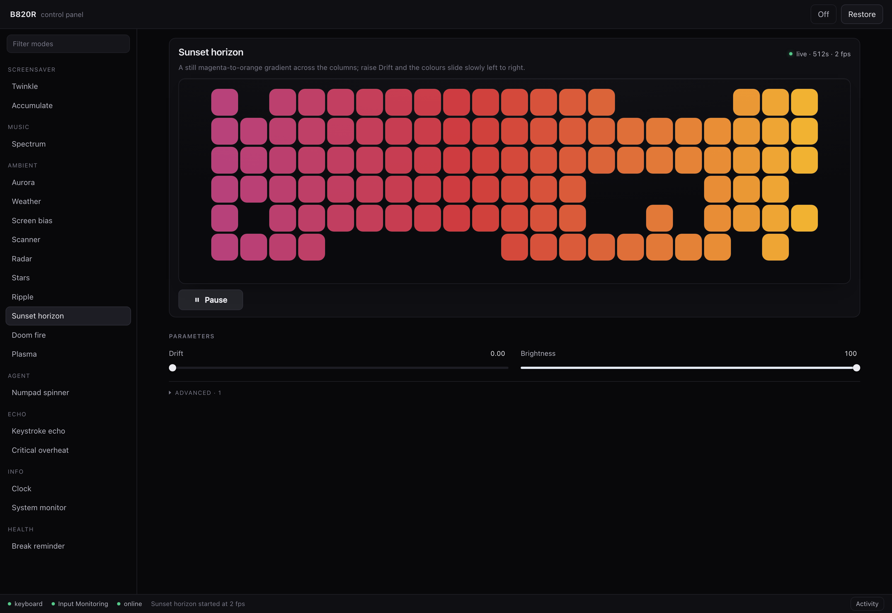

# Bloody B820R RGB control for macOS

Per-key RGB lighting for the A4Tech **Bloody B820R** keyboard on macOS: 19
lighting modes, a local browser control panel with a live preview of the real
104-key matrix, and a documented HID protocol. Python 3, standard library only.

[](LICENSE)
[](https://www.python.org/)
[](#requirements)
[](#requirements)



## What this is

The Bloody B820R has 104 individually addressable RGB keys, but A4Tech's
software and its effects engine are Windows-only. This is a macOS alternative:
it talks to the keyboard's vendor HID collection directly through IOKit
(`ctypes`, no `pip install`), so every key gets its own colour, at its own
address, at up to ~25 frames per second.

On top of that low-level driver sits a control panel, a set of standalone
renderers (screensaver, music visualiser, ambient looks, clock, system gauges,
keystroke echo, typing break reminder), and a small HTTP API so any script can
push a frame to the keys.

## Features

- **104 keys, individually addressed.** Colours are written per key, not per
  zone, against the board's true 6x21 matrix (holes included, never lit).
- **Control panel** served on `127.0.0.1:8777`: mode library, parameter
  sliders generated from each mode's schema, and a preview that reproduces the
  physical key layout.
- **19 modes in 7 groups** — see the [mode table](#modes).
- **Keystroke echo** with a white-hot flash, a slow heat trail, ripple and
  fireball layers, driven by the keyboard's own HID reports.
- **Music visualiser** from system audio, the microphone, or a synthetic test
  loop, using a real log-spaced FFT across 21 columns.
- **Informational modes**: clock in a 3x5 bitmap font, CPU/RAM/network/battery
  gauges, typing break reminder.
- **HTTP frame API** for external producers: one `POST` with 104 RGB triples.
- **Crash-safe ownership.** The panel takes control of the LED channel, and
  hands it back to the firmware on Stop, Restore, Ctrl-C or a renderer crash.
- **No build step, no packages** for the core. Music is the only mode that
  wants `numpy`.

## Requirements

| Requirement | Detail |
|---|---|
| Keyboard | A4Tech Bloody B820R (VID `0x09DA`, PID `0xFA10`) |
| OS | macOS 12 or newer (system audio capture needs ScreenCaptureKit, 12.3+) |
| Python | 3.9 or newer, standard library only |
| Music visualiser | `numpy`; `ffmpeg` only for the `--mic` source |
| System audio | `xcrun swiftc` (Xcode Command Line Tools) to build `audiotap` |
| Permissions | **Input Monitoring** for the app you launch the panel from; **Screen & System Audio Recording** for screen/audio modes |

Grant permissions in *System Settings → Privacy & Security*, then restart the
terminal app — macOS reads the grant at process start.

## Installation

```sh
git clone https://github.com/rasulov1337/b820r-rgb-mac.git
cd b820r-rgb-mac
python3 ui.py
```

That is the whole install. The panel opens in your browser at
`http://127.0.0.1:8777`.

Check the connection first if you want to confirm permissions before anything
else:

```sh
python3 keyboard.py --list
```

```
Input Monitoring for this process: granted
Device:    USB Device
VID/PID:   0x09DA / 0xFA10
Transport: USB
LED channel: feature report 7, 64 byte packets (ID + 63 payload)
Open:      ok
```

For the music visualiser, build the audio tap once (the Python side rebuilds
it automatically whenever the Swift source is newer):

```sh
xcrun swiftc -O -o audiotap audiotap.swift \
    -framework ScreenCaptureKit -framework CoreMedia -framework AVFoundation
pip3 install numpy
```

## Quick start

### Control panel

```sh
python3 ui.py                    # http://127.0.0.1:8777, opens a browser
python3 ui.py --port 9000 --no-browser
```

Pick a mode in the left rail, press **Play**, then turn the knobs. A parameter
change restarts only the current renderer, so the board never flickers and the
preview stays live.

| Key | Action |
|---|---|
| `/` | filter the mode rail |
| `↑` `↓` / `Home` `End` | walk the modes |
| `Space` | play / pause |
| `o` | LEDs off |
| `r` | restore firmware effects |
| `Esc` | close the activity log |

`http://127.0.0.1:8777/#fire` deep-links to a mode. Only one panel may own the
LED channel; a second one refuses to start (`.b820r.lock`).

### From the shell

```sh
python3 keyboard.py                    # twinkle until Ctrl-C
python3 keyboard.py --hold             # accumulate until the board fills
python3 music.py                       # spectrum bars from system audio
python3 music.py --style beat --test   # no permissions needed
python3 ambient.py fire                # Doom fire
python3 ambient.py sunset --drift 0.3  # gradient that slides
python3 clock.py                       # HH:MM in 3x5 digits
python3 sysmon.py                      # CPU / RAM / network / battery
python3 echo.py --blast --ember 0.35   # keystroke echo with fireballs
python3 breaktime.py --limit 45 --break 5
python3 agent.py -- make build         # numpad spinner while a command runs
python3 push.py --text "HELLO" --once  # marquee via the panel API
```

`python3 keyboard.py --off` blanks the board, `--restore` hands it back to the
firmware. While any script owns the channel, Fn+F12 does nothing.

## Modes

All modes are available in the panel; most also run standalone.

| Group | Mode | What it does |
|---|---|---|
| Screensaver | Twinkle | A fresh random handful of keys every tick. |
| Screensaver | Accumulate | Keys light and stay lit until the board fills, then it resets. |
| Music | Spectrum | Bars, pulse or beat from system audio, microphone or test loop. |
| Ambient | Aurora | Slow drifting colour field across the whole board. |
| Ambient | Weather | Rain, snow, fog, clouds or storm — live from Open-Meteo, or forced. |
| Ambient | Screen bias | Washes the board in the average colour of the screen or an image. |
| Ambient | Scanner | Knight Rider bounce with a fading trail along one row. |
| Ambient | Radar | Rotating sweep with contacts that fade behind it. |
| Ambient | Stars | Parallax twinkle with occasional shooting stars. |
| Ambient | Ripple | Drops send expanding rings outward across the key matrix. |
| Ambient | Sunset horizon | Magenta-to-orange gradient; raise `--drift` and it slides. |
| Ambient | Doom fire | Flames rise off the bottom row, cooling white to red as they climb. |
| Ambient | Plasma | Sum-of-sines colour field, or drifting lava metaballs. |
| Agent | Numpad spinner | Comet on the numpad ring; green when the command succeeds, red when it fails. |
| Echo | Keystroke echo | Flash, heat trail and optional rings on every key press. |
| Echo | Critical overheat | Black board, amber fireball per press, overload glow while typing fast. |
| Info | Clock | HH:MM in a 3x5 font, blinking colon, seconds sweep, or binary rows. |
| Info | System monitor | CPU load, memory, network rate and battery as four gauge rows. |
| Health | Break reminder | Function row fills green to red over the work limit; resting resets it. |

Ambient looks:

```sh
python3 ambient.py {aurora,weather,bias,scanner,radar,stars,ripple,sunset,fire,plasma}
```

## How it works

The keyboard exposes several HID interfaces under one VID/PID, so the LED
channel is identified by its vendor report descriptor (`06 52 FF` — usage page
`0xFF52`) rather than by product string. It takes a feature report with ID 7
and 63 payload bytes; a full frame is six of those reports, splitting each
colour channel across two halves (R1, R2, G1, G2, B1, B2).

Two details are worth knowing if you write your own client:

- On macOS, `IOHIDDeviceSetReport` needs the **whole 64-byte buffer with the
  report ID at byte 0**. Passing the ID separately shifts every payload byte by
  one: the call returns success and the firmware silently ignores the frame.
- Feature reports must be spaced ~3 ms apart, which caps the frame rate around
  25 fps. Hammering the channel returns `kIOReturnNotReady`.

`AGENTS.md` documents the protocol bytes, the key index order, and the
per-mode internals.

## HTTP frame API

The panel is also a frame server. Start it, then push colours from anything
that can send JSON:

```sh
python3 - <<'PY'
import json, urllib.request
frame = [[0, 0, 0]] * 104        # one [r, g, b] per key
frame[0] = [255, 0, 0]           # Esc
urllib.request.urlopen(urllib.request.Request(
    "http://127.0.0.1:8777/api/frame",
    data=json.dumps({"colors": frame, "ttl": 5}).encode())).read()
PY
```

`colors` is either 312 flat channel values or 104 `[r, g, b]` triples. A push
stops the current mode and takes over the board. With `ttl > 0` a watchdog
returns the board to the firmware when frames stop arriving, so a dead
producer cannot leave the LEDs frozen.

`push.py` is the reference client: solid fill (`--color`), an image resampled
onto the matrix (`--image`), or scrolling text in the bitmap font
(`--text "HI" --speed 8 --once`).

## Troubleshooting

| Symptom | Cause | Fix |
|---|---|---|
| `Open: 0xE00002E2` / `kIOReturnNotPermitted` | The hosting app lacks Input Monitoring | Grant it in System Settings → Privacy & Security → Input Monitoring, then restart the terminal |
| Music runs but shows silence | Screen & System Audio Recording not granted, or granted after launch | Restart the terminal app (and the panel) after granting |
| Fn+F12 does nothing | The script holds the board in direct mode | `python3 keyboard.py --restore`, replug, or press Restore in the panel |
| `address already in use` | Another panel owns the port or the lock | Stop the other `ui.py`, or pass `--port` |
| Board lags or skips frames | FPS above what the channel carries (~25) | Lower FPS in the panel, or `--fps` on the CLI |

## FAQ

**Does it work with the original Bloody B820 (without R)?** Maybe — the frame
layout looks shared across Bloody boards — but only the B820R is tested here.
Run `python3 keyboard.py --list` and see whether the LED channel is found.

**Does it work on Windows or Linux?** No. The driver is written against macOS
IOKit, and the permission model, audio capture and screen sampling are all
macOS-specific.

**Can it brick the keyboard?** No. The board stores no persistent state here:
`--restore` (or a replug) returns it to the firmware effects.

**Why not OpenRGB?** OpenRGB gained B820R support in 2024 for setting colours,
but it is a device-management tool, not an effects engine: it does not run the
per-key animations, audio response or keystroke echo in this repo. If all you
want is a static colour, OpenRGB may be enough.

**Does it conflict with the vendor software?** The vendor software is
Windows-only, so there is nothing to conflict with on a Mac.

## Compatible hardware

Confirmed working:

- A4Tech Bloody B820R (VID `0x09DA`, PID `0xFA10`, 104 keys, 6x21 matrix)

Other Bloody boards may use the same six-report frame layout; open an issue
with your model, VID/PID and report descriptor if you want it supported.

Related projects: [OpenRGB](https://openrgb.org/),
[hidapi](https://github.com/libusb/hidapi).

## Contributing

- The core must stay standard library only; optional extras (`numpy`,
  `ffmpeg`, Swift) belong behind a mode's own code path.
- Adding a mode to the panel costs a few lines in `define_modes()` — a label, a
  schema and a builder. The page renders the controls from the schema.
- Read `AGENTS.md` before touching the driver; it records the invariants
  (framing, timing, permissions) that are easy to break silently.
- Run `python3 ui.py` and exercise the mode you changed. Hardware quirks
  usually show up as a silent no-op, not an exception.

## License

MIT — see [LICENSE](LICENSE).
